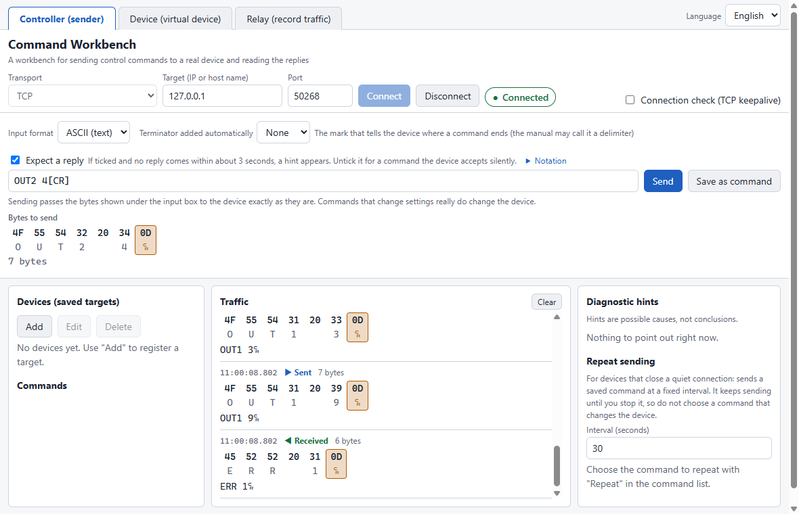

# Command Workbench

[日本語](README_JP.md)

A Windows desktop tool for sending control commands to AV and other network devices, and reading what they answer. It shows you the exact bytes before anything is sent, explains what to check when a device stays silent, and includes a virtual device to practice against when you have no real equipment.

> **Status: early version (0.2.0).** Everything described below works.



## Why

Equipment manuals describe control commands in their own notation (`[CR]`, `<CR><LF>`, `0x0D`). Turning that notation into the bytes that actually go over the wire, and working out why a device does not answer, is where beginners get stuck. Command Workbench closes that gap: you type the command the way the manual writes it, see the exact bytes, send it, and read the reply.

## Three roles, three tabs

| Tab | What it does |
|---|---|
| **Controller** | Sends commands to a real or virtual device over TCP or UDP and shows the replies as hex and text, with hints when something is wrong. |
| **Device (virtual device)** | Pretends to be a device, driven by a definition file you can read and write (JSON, no scripts). Practice without equipment, or check how your control side copes with a device that goes silent. |
| **Relay (record traffic)** | Sits between a controller and a real device, passes everything through unchanged, records it, and can draft a virtual-device definition from the recording. |

It does not emulate any specific manufacturer's or model's device, and it is **not a guarantee of how real equipment behaves**. Commands that change settings really do change the device.

## Download and start

The program is a single Windows file; there is nothing to install. Extract the ZIP to a folder you can write to and run `Command Workbench-0.2.0-portable.exe`. A first start can take several seconds. The ZIP also holds this README (English and Japanese), the **manual** (`manual/manual.html`, with screenshots; GitHub shows HTML as source, so open it from the ZIP or a clone), `docs/` (the guides) and `samples/` (sample definitions you can read and copy).

## Your first three minutes (no equipment needed)

1. Open the **Device (virtual device)** tab, choose **Sample matrix switch** from the **Definition** list and press **Start**. The port appears in the status badge.
2. Open the **Controller** tab, enter `127.0.0.1` and that port, and press **Connect**. The message on connect appears.
3. Type `PWR?[CR]`. The exact bytes (`50 57 52 3F 0D`) appear under the input box. Press **Send**.
4. Try `PWR 1[CR]` (silent on success, then a notification), `OUT1 3[CR]` and `OUT1 9[CR]` (an error), and watch both sides.
5. In the device tab, try **Fault injection** (drop a reply, add a delay, close all connections) and see which hint appears in the controller.

To use a real device, enter its IP address and port instead. Read "Staying safe with real equipment" below first.

## Manual and guides

- **Manual** (`manual/manual.html` English, `manual/manual_JP.html` Japanese): the first five minutes, the screen, each tab, troubleshooting by symptom, safety, and a glossary.
- [Writing a device definition](docs/device-definition.md)
- [Recording traffic with the relay, and the draft definition](docs/relay-and-draft.md)
- [Using UDP](docs/udp.md)

## What it can do

- **Manual notation in, exact bytes out.** Type `GETPWR[CR]` and see `47 45 54 50 57 52 0D` before anything is sent.
- **A table instead of JSON for a first virtual device.** Copy the command table from a manual (or paste it), and the program writes the definition for you and shows the JSON beside it.
- **Hex and text side by side.** CR and LF are colored and drawn with symbols so they cannot hide.
- **Diagnostic hints.** When there is no reply, the connection is refused, or the device closes the connection, the app suggests what to check next. Hints are possible causes, not conclusions.
- **Saved commands per device**, with a read-only mode and a "query" / "set" classification. Connection keep-alive options: TCP keepalive, and sending a query command at a fixed interval.
- **A virtual device with real-equipment quirks**: a limit on simultaneous connections, a connection closed after a time without commands, a device that stops answering, a slow start-up, commands that must not come too fast. **Fault injection** while it runs: drop the next replies, delay replies, stop responding, close all connections.
- **A transparent relay** that records both directions and drafts a definition. The draft writes only what the recording shows for certain and lists everything it could not decide; it is a starting point, not a guarantee.
- **UDP as well as TCP** in all three tabs (one item per datagram). UDP has no connection and no feedback, so the program says what it cannot know.

The screen is available in Japanese and English.

**Not yet:** login or challenge-response handshakes; UDP broadcast, multicast and IPv6; drafting a definition from a UDP recording.

## Notation

| You type | Bytes |
|---|---|
| `[CR]` `<CR>` `\r` | `0D` |
| `[LF]` `<LF>` `\n` | `0A` |
| `[CRLF]` `<CR><LF>` | `0D 0A` |
| `[NUL]` `[STX]` `[ETX]` `[ACK]` `[NAK]` `[ESC]` `[SP]` `[TAB]` … | the control character with that name (case does not matter) |
| `0x0D` `\x0D` | one byte in hex (exactly two digits) |
| `\\` `\[` `\<` | the character itself |
| anything else | the character as text (UTF-8) |

- Write several hex bytes with spaces between them: `0x0D 0x0A`. `0x0D0x0A` is rejected on purpose.
- Choose **HEX** as the input format to type raw bytes such as `47 45 54 50 57 52 0D`.
- The **ASCII** input format also takes the names and escapes above. Characters outside ASCII (Japanese, for example) are sent as **UTF-8** bytes; a device that expects another encoding (such as Shift_JIS) needs the bytes typed in **HEX**. The bytes shown under the input box are exactly what is sent.
- **Terminator added automatically** appends CR, LF or CR+LF. If your input already ends with a terminator and an automatic one is also selected, a warning is shown, because the terminator would be sent twice.
- Anything the notation cannot read is explained with its position instead of being guessed.

## Staying safe with real equipment

- **Query or set.** Every saved command has a kind. A **query** reads the device without changing it. A **set** command may change it. If unsure, choose **set**.
- **No confirmation when sending.** Pressing **Send** is the confirmation, so check the bytes shown under the input box before you press it. A **set** command and raw input are sent at once, just like a query.
- **Saving a "query" is confirmed**, in a dialog owned by the program itself that lists the exact bytes, because read-only mode lets queries through. Changing the text of a saved query asks again. Turning read-only mode **off** asks for confirmation too. Both dialogs default to **Cancel**.
- **Read-only mode** allows only saved queries; it blocks set commands and raw input.
- A command longer than **256 bytes** cannot be saved as a query, because the confirmation could not show it in full.
- **Repeat sending** accepts queries only, never starts while read-only mode is on, and stops when the connection ends. TCP keepalive is a different thing (the operating system detects a lost peer); a device may not count it as activity.
- **The virtual device** listens only on `127.0.0.1` unless you choose the whole network; that choice asks for confirmation and keeps a warning visible, because other machines can then connect. Connections, message sizes and rates are limited.
- **UDP** adds one more risk: a sender address can be forged, so listening on the whole network could be used to send answers to a third party. The confirmation says so and the program limits what it sends. The controller only sends UDP to private addresses, never to broadcast or multicast addresses.
- **The TCP controller connects to any address you type**, because real equipment can be anywhere on your network. The UDP controller and the relay only reach your own network (private addresses). Whatever the program shows on the screen is treated as untrusted text. See [SECURITY.md](SECURITY.md) for how the screen is isolated.
- **The relay** only forwards to private addresses and listens only on this PC unless you choose the whole network (confirmation naming the target, warning kept visible). Recordings can contain passwords: check a saved file before you share it.
- Everything above is checked by the program's main process, not by the screen.

## Where your data is saved

Commands are saved in `workbench-commands.json` in the **same folder as the program**. Put the program in a folder you can write to. If saving fails, the app says why and does not save somewhere else. If the file cannot be read (broken, newer format, too large), the app **does not overwrite it**: rename the file to keep a copy and restart. Leftover `.tmp` files after a crash are reported and never deleted automatically.

## Troubleshooting

The manual has a symptom-by-symptom list. The short version:

- **A warning appears when starting.** The program is not code-signed, so Windows or antivirus software may warn about it.
- **Slow first start.** The single-file program unpacks itself on start.
- **The connection fails.** Check the IP address, the port, the cable and the network. The controller only connects out to the address you enter. The virtual device listens on this PC only by default, so no firewall rule is normally needed; choosing the whole network may make your firewall ask for permission.

## Development

Requires Node.js. The only dependencies are development tools (Electron and its packager).

```
npm install
npm test        # unit and integration tests
npm start       # run from source
npm run dist    # build the single-file Windows program into dist/
npm run package # build the release ZIP (run dist first)
```

Some environments (for example a VS Code extension host) set `ELECTRON_RUN_AS_NODE=1`, which makes Electron exit without opening a window; `npm start` removes it for you.

Local-only working folders (`.agents/`, `.tasks/`, `.docs/`, `.scratch/`, `.scripts/`, `.reference/`) are kept out of Git through `.git/info/exclude`, which is not shared by cloning. After cloning, add those names to `.git/info/exclude` yourself.

## License

MIT. See [LICENSE](LICENSE). The program is built on Electron and Chromium; their license notices are in the `licenses` folder of the download. To report a security problem, see [SECURITY.md](SECURITY.md).

"Command Workbench" is the name of this independent, personal open-source project. It is not affiliated with, endorsed by, or connected to any company or product that uses a similar name. All product and company names mentioned (such as Windows, Electron and GitHub) belong to their respective owners and are used only to describe compatibility.
