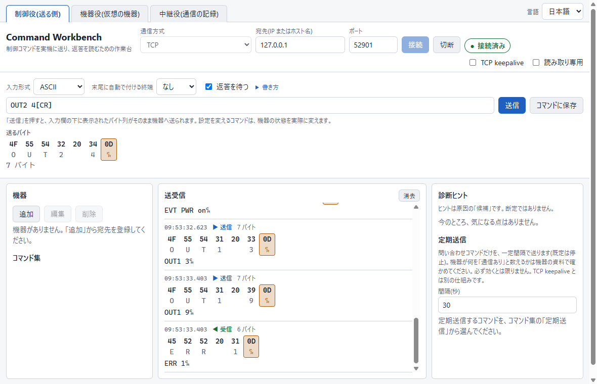

# Command Workbench

[English](README.md)

AV などのネットワーク機器へ制御コマンドを送り、返答を読むための Windows 用デスクトップツールです。送る前に実際のバイトを見せ、機器が黙っているときは次に確かめることを示します。実機がないときの練習台になる、仮想の機器も入っています。

> **状態: 初期版(0.3.0)。** 以下はすべて動きます。



## なぜ作ったか

機器のマニュアルは、制御コマンドを独自の書き方(`[CR]`、`<CR><LF>`、`0x0D`)で説明しています。その書き方を、実際に送るバイトに直すことと、機器が応答しない原因を探ることが、初心者のつまずきです。Command Workbench は、マニュアルの書き方のままコマンドを入力し、実際に送るバイトを見て、送信し、返答を読めるようにして、このギャップを埋めます。

## 3つの役割(3つのタブ)

| タブ | やること |
|---|---|
| **制御役** | 実機や仮想の機器へ TCP または UDP でコマンドを送り、返答を16進とテキストで表示します。うまくいかないときはヒントを出します。 |
| **機器役(仮想の機器)** | 読み書きできる定義ファイル(JSON、スクリプトなし)のとおりに、機器のふりをします。実機なしの練習や、機器が黙ったときの制御側の動きの確認に使えます。 |
| **中継役(通信の記録)** | 制御役と実機の間に入り、通信をそのまま通しながら記録し、記録から仮想の機器の定義の下書きを作れます。 |

特定のメーカーや機種の機器を再現するものではなく、**実機の動作の保証ではありません**。設定を変えるコマンドは、機器の状態を実際に変えます。**練習と検証のための道具です。稼働中の本番の機器には使わないでください。**試験用の機器か、仮想の機器で使ってください。

## ダウンロードと起動

プログラムは Windows 用の単一ファイルで、インストールは要りません。ZIP を書き込めるフォルダに展開し、`Command Workbench-0.3.0-portable.exe` を実行します。初回の起動は数秒かかることがあります。ZIP には、この README(英日)、**説明書**(`manual/manual_JP.html`、画面の写真つき。GitHub は HTML をソースとして表示するので、ZIP かクローンから開いてください)、`docs/`(ガイド)、`samples/`(読んで複製できるサンプル定義)も入っています。

## 最初の3分(実機は要りません)

1. **機器役(仮想の機器)**のタブを開き、**定義**の一覧から **Sample matrix switch** を選んで**開始**を押します。ポートは状態のバッジに出ます。
2. **制御役**のタブを開き、`127.0.0.1` とそのポートを入力して、**接続**を押します。接続時のメッセージが表示されます。
3. `PWR?[CR]` と入力します。入力欄の下に、実際に送るバイト(`50 57 52 3F 0D`)が出ます。**送信**を押します。
4. `PWR 1[CR]`(成功すると無言、そのあと通知)、`OUT1 3[CR]`、`OUT1 9[CR]`(エラー)を送って、両側を見ます。
5. 機器役のタブで**異常の注入**(返答を捨てる、遅らせる、全接続を閉じる)を試し、制御役にどのヒントが出るかを見ます。

実機を使うときは、実機の IP アドレスとポートを入力します。先に、下の「実機を安全に使うために」を読んでください。

## 説明書とガイド

- **説明書**(`manual/manual_JP.html` 日本語、`manual/manual.html` 英語): 最初の5分、画面の見かた、各タブ、症状からの困ったとき、安全、用語集。
- [仮想の機器の定義の書き方](docs/device-definition_JP.md)
- [中継役での通信の記録と、定義の下書き](docs/relay-and-draft_JP.md)
- [UDP を使う](docs/udp_JP.md)

## できること

- **マニュアルの書き方を入力すると、実際に送るバイトが見える。** `GETPWR[CR]` と入力すると、送る前に `47 45 54 50 57 52 0D` と表示します。
- **最初の仮想の機器は、JSON ではなく表で作れます。** マニュアルのコマンドの表を写す(貼り付ける)と、定義を作り、その JSON を横に表示します。同じ表を、制御役の保存コマンドにも追加できるので、入力は1回で済みます。
- **16進とテキストを並べて表示。** CR と LF は色と記号で目立たせるので、見落としません。
- **診断ヒント。** 返答がないとき、接続を拒否されたとき、機器から切断されたときに、次に確認することを示します。ヒントは原因の「候補」であり、断定ではありません。
- **機器ごとにコマンドを保存**できます。接続を保つ補助として、TCP keepalive の入切と、保存したコマンドを一定間隔で送る機能があります。
- **実機の癖をもつ仮想の機器**: 同時接続数の上限、一定時間コマンドがないと接続を閉じる、黙って応答しなくなる、起動直後の無応答、速すぎるコマンドの無視。動かしている間の**異常の注入**: 次の返答を捨てる、返答を遅らせる、応答を止める、全接続を閉じる。
- **透過の中継役**: 両方向を記録し、定義の下書きを作ります。下書きには、記録から確実に分かることだけを書き、決められなかったことはすべて一覧にします。出発点であり、保証ではありません。
- **3つのタブすべてで TCP に加えて UDP**(1データグラムが1項目)。UDP には接続も手ごたえもないので、プログラムは「分からないこと」を明示します。

画面は日本語と英語に対応しています。

**まだないこと:** ログインやチャレンジ・レスポンスの握手。UDP のブロードキャスト・マルチキャスト。UDP の記録からの定義の下書き。IPv6 には対応していません。

## 書き方

| 入力 | バイト |
|---|---|
| `[CR]` `<CR>` `\r` | `0D` |
| `[LF]` `<LF>` `\n` | `0A` |
| `[CRLF]` `<CR><LF>` | `0D 0A` |
| `[NUL]` `[STX]` `[ETX]` `[ACK]` `[NAK]` `[ESC]` `[SP]` `[TAB]` など | その名前の制御文字(大文字・小文字は区別しません) |
| `0x0D` `\x0D` | 16進1バイト(ちょうど2桁) |
| `\\` `\[` `\<` | その文字そのもの |
| 上記以外 | 文字(UTF-8)として送ります |

- 16進を続けて書くときは、`0x0D 0x0A` のように空白で区切ってください。`0x0D0x0A` は、意図的にエラーにしています。
- `47 45 54 50 57 52 0D` のように生のバイトを入力するときは、入力形式に**HEX(16進)**を選びます。
- 入力形式の**ASCII(テキスト)**でも、上の名前やエスケープを使えます。ASCII にない文字(日本語など)は **UTF-8** のバイト列として送り、含まれていると位置を示す警告が出ます(マニュアルからコピーした全角の英数字や空白は、ASCII に見えても別の文字です)。別の文字コード(Shift_JIS など)を期待する機器には、**HEX** でバイト列を直接入力してください。入力欄の下に表示されるバイト列が、実際に送られるものです。
- **末尾に自動で付ける終端文字**は、CR・LF・CR+LF を末尾に足します。入力がすでに終端で終わっていて、自動の終端も選ばれているときは、終端が二重に送られるので、警告を出します。
- 書き方を読み取れないときは、推測せずに、位置を示して理由を説明します。

## 実機を安全に使うために

- **送信時の確認はありません。** 「送信」を押すことが確認です。押す前に、入力欄の下に出ているバイトを確認してください。保存したコマンドも直接入力も、すぐに送られます。
- **定期送信**は、保存したコマンドを、止めるまで何度も送ります(接続が終わると止まります)。機器の状態を変えるコマンドは、何度も送られるので、選ぶときに注意してください。TCP keepalive は別のものです(OS が相手の消失を検知する仕組み)。機器が通信として数えるとは限りません。
- **仮想の機器**は、ネットワーク全体を選ばない限り、`127.0.0.1` でだけ待ち受けます。ネットワーク全体を選ぶと、他の機器から接続できるので、確認を求め、警告を出し続けます。接続・メッセージの大きさと頻度には、上限があります。
- **UDP** には、もう1つの危険があります。送信元アドレスを偽れるため、ネットワーク全体で待ち受けると、第三者へ返答を送らせることに使われかねません。確認ダイアログがこれを伝え、送る量をプログラムが制限します。制御役は UDP をプライベートアドレスへだけ送り、ブロードキャスト・マルチキャストのアドレスへは送りません。
- **TCP の制御役は、入力された任意のアドレスへ接続します。** 実機がネットワークのどこにあるか分からないためです。UDP の制御役と中継役は、自分のネットワーク(プライベートアドレス)にしか届きません。画面に表示する内容は、すべて信頼しないテキストとして扱います。画面の隔離のしかたは、[SECURITY.md](SECURITY.md) を参照してください。
- **中継役**は、プライベートアドレスへだけ転送し、ネットワーク全体を選ばない限り、この PC だけで待ち受けます(選ぶと、転送先を示す確認が出て、警告が出続けます)。記録にはパスワードが含まれることがあるので、保存したファイルは、共有する前に確認してください。
- 上記の確認はすべて、画面ではなく、プログラムの本体側が行います。

## データの保存先

コマンドは、**プログラムと同じフォルダ**の `workbench-commands.json` に保存します。プログラムは、書き込めるフォルダに置いてください。保存に失敗したときは、理由を表示し、別の場所には保存しません。ファイルを読めないとき(壊れている、新しい形式、大きすぎる)は、**上書きしません**。ファイル名を変えて控えを残し、再起動してください。クラッシュで残った `.tmp` ファイルは、通知するだけで、自動では削除しません。

## トラブルシューティング

症状ごとの一覧は、説明書にあります。要点だけ書きます。

- **起動時に警告が出る。** プログラムにコード署名がないので、Windows やウイルス対策ソフトが警告することがあります。
- **初回の起動が遅い。** 単一ファイルのプログラムは、起動時に自分自身を展開します。
- **接続できない。** IP アドレス、ポート、ケーブル、ネットワークを確認してください。制御役は、入力したアドレスへ接続するだけです。仮想の機器は、既定ではこの PC だけで待ち受けるので、通常、ファイアウォールの設定は要りません。ネットワーク全体を選ぶと、ファイアウォールが許可を求めることがあります。

## 開発

Node.js が必要です。依存は、開発用のツール(Electron とそのパッケージ化ツール)だけです。

```
npm install
npm test        # 単体テストと結合テスト
npm start       # ソースから起動
npm run dist    # 単一ファイルの Windows 用プログラムを dist/ に作る
npm run package # 配布用の ZIP を作る(先に dist が必要)
```

環境によっては(たとえば VS Code の拡張機能の中)、`ELECTRON_RUN_AS_NODE=1` が設定されていて、Electron が窓を出さずに終了します。`npm start` は、これを外して起動します。

ローカル専用の作業フォルダ(`.agents/`、`.tasks/`、`.docs/`、`.scratch/`、`.scripts/`、`.reference/`)は、`.git/info/exclude` で Git から除外しています。`.git/info/exclude` はクローンでは共有されないので、クローンした後に、これらの名前を自分で追加してください。

## ライセンス

MIT。[LICENSE](LICENSE) を参照してください。プログラムは Electron と Chromium の上に作られています。それらのライセンス表示は、ダウンロードの `licenses` フォルダにあります。セキュリティ上の問題の報告は、[SECURITY.md](SECURITY.md) を参照してください。

「Command Workbench」は、個人が公開する独立したオープンソースプロジェクトの名前です。似た名前を使う企業・製品とは、提携・承認・関係のいずれもありません。文中に出る製品名・会社名(Windows、Electron、GitHub など)は各権利者のもので、対応環境の説明のためにだけ使っています。
